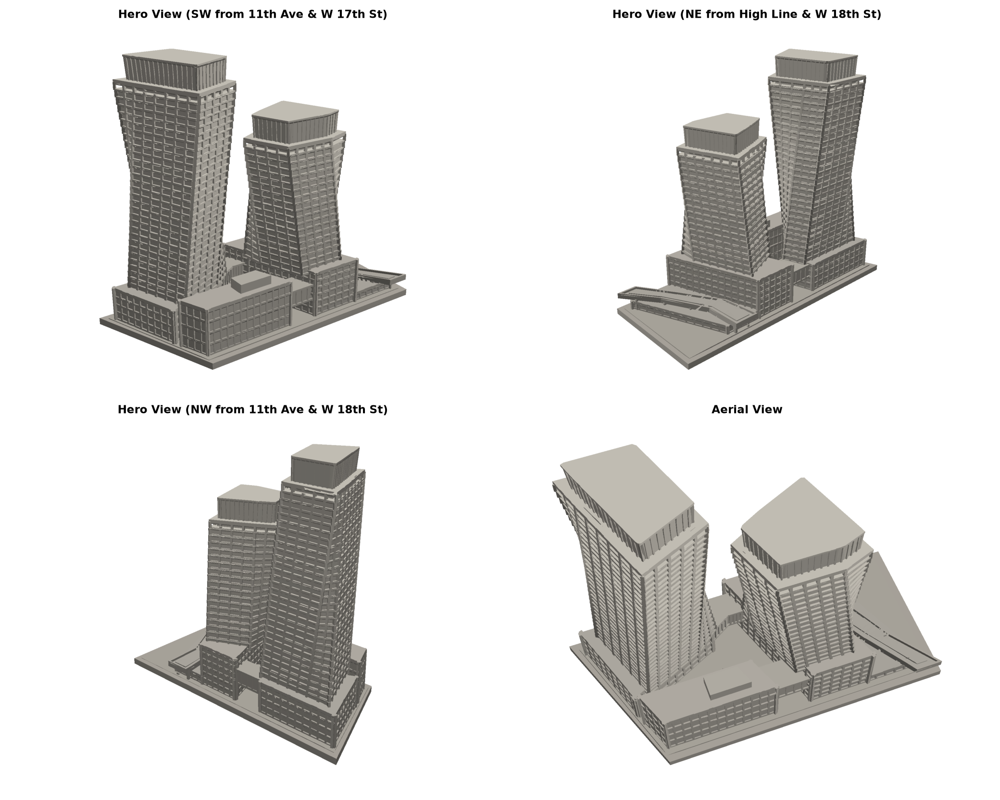

# One High Line — 3D-Printable Architectural Model (1:450)

A parametric, 100% watertight, FDM-printable 1:450 scale architectural model of **One High Line** (500 West 18th Street, Manhattan, designed by Bjarke Ingels Group), generated procedurally in Python using `manifold3d` and `trimesh`.



## Architectural Geometry

Both towers are constructed from exact 6-vertex floor polygons registered from the building's architectural drawings:

- **Planar Parallelogram Main Facades (N, S, E, W)**: All four main facades maintain constant orientation and width from bottom to top, built as strictly plumb, one-story vertical blocks with 90° rectangular recessed windows and vertical travertine piers that stair-step horizontally from floor to floor.
- **Twisting Corner Facets (NW & SE)**: Twisting is isolated strictly to the NW and SE corners:
  - **West Tower** (`5W–37W` + mechanical crown `PPT W`, 435'6" → 295.0 mm): W=6, S=5, **SE twist=3**, E=3, N=5, **NW twist=2** bays.
  - **East Tower** (`7E–27E` + mechanical crown `PPT E`, 336'2" → 227.7 mm): W=4, S=5, **SE twist=1 (wide ~2× bay)**, E=7, N=4, **NW twist=2** bays.
- **Top Penthouse Colonnades & Louvered Crowns**: Deeply recessed top-floor wrap-around loggias (`36W` / `26E`) topped with flared, vertically louvered mechanical crowns.
- **Full City-Block Context**: West Podium, 4-band South Retail building + rooftop bulkhead, East Podium, East Retail Pavilion, **North Bridge** (kinked courtyard plan), **South Bridge** (over the porte-cochere driveway), the **High Line** elevated park with support columns and parapets, and the full city-block plinth with sidewalks and courtyard planters.

## Printable Files (`output/`)

All meshes are verified `watertight=True` and `is_volume=True`.

| File | Dimensions (mm) | Description |
| --- | --- | --- |
| `output/one_high_line_complete_1_450.stl` / `.3mf` | `331.9 × 149.0 × 303.1` | Complete assembled 1:450 display model |
| `output/part1_west_base_and_lower.stl` | `166.1 × 149.0 × 167.3` | West plinth, West Podium, South Retail, West Tower `5W–20W` + alignment pegs |
| `output/part2_west_tower_upper.stl` | `128.2 × 103.2 × 142.6` | West Tower `21W–37W` + penthouse colonnade + crown + alignment sockets |
| `output/part3_east_base_and_lower.stl` | `194.5 × 149.0 × 136.8` | East plinth, East Podium, East Retail, High Line, East Tower `7E–16E` + pegs/sockets |
| `output/part4_east_tower_upper.stl` | `100.7 × 98.2 × 105.8` | East Tower `17E–27E` + penthouse colonnade + crown + alignment sockets |
| `output/part5_north_bridge.stl` | `54.2 × 37.3 × 19.8` | Snap-in North Bridge (prints flat, zero supports) |
| `output/part6_south_bridge.stl` | `52.8 × 27.1 × 19.8` | Snap-in South Bridge (prints flat, zero supports) |

## Recommended FDM Print Settings (0.4 mm Nozzle)

- **Layer height**: `0.16 mm` (or `0.12 mm` for crispest spandrels and crown louvers)
- **Perimeters / Infill**: 2–3 walls, 10–15% gyroid infill
- **Supports**:
  - **Parts 1, 2, 4, 5, 6**: **None** (spandrels use 45° chamfered undersides; both bridges print flat on the bed).
  - **Part 3**: **Tree supports (build plate only)** under the elevated High Line deck.
- **Filament**: Matte ivory / limestone / marble PLA pairs naturally with the building's Roman travertine aesthetic.
- **Assembly**: Alignment pegs include `0.25–0.35 mm` radial clearance; dry-fit first, then bond with CA glue.

## Regenerating the Models

```bash
python3 -m venv .venv
source .venv/bin/activate
pip install -r requirements.txt

# Rebuild all STL/3MF files into output/
python build_one_high_line.py

# Render 3D studio previews into renders/
python render_preview.py
```

*(Note: `extract_*.py`, `register_towers.py`, `fit_exact_geometry.py`, and `verify_alignment.py` are the original extraction/verification scripts used to derive `extracted/tower_floors.json` from the offering plan PDF; set `OHL_PDF_PATH` if re-running them.)*
